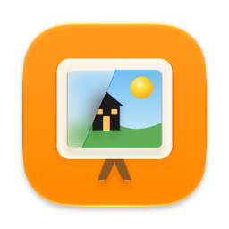
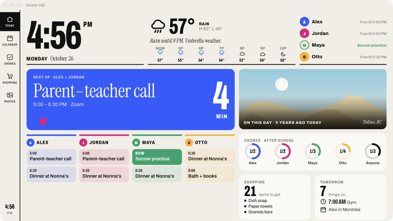

<h1 align="center">Home HQ</h1>

Wes Bos's family dashboard: the day, calendar, chores, shopping and photos at a glance.

## Make Home HQ yours

Each opens Lamp with a copy of Home HQ and that change, ready to send:

- [Put it on our kitchen tablet](https://lamp.dev/?repo=https://github.com/lampdotdev/homehq&from=readme&ask=Put%20it%20on%20our%20kitchen%20tablet)
- [Put it on our photo frame](https://lamp.dev/?repo=https://github.com/lampdotdev/homehq&from=readme&ask=Put%20it%20on%20our%20photo%20frame)
- [Add a countdown to school](https://lamp.dev/?repo=https://github.com/lampdotdev/homehq&from=readme&ask=Add%20a%20countdown%20to%20school)

## Open it in Lamp

[Lamp](https://lamp.dev) is a Mac app that builds apps from a description and changes them as you ask. [Open Home HQ in Lamp](https://lamp.dev/?repo=https://github.com/lampdotdev/homehq&from=readme) for a copy of your own, to use and to change as you like, with the credits below kept. Or, in Lamp, choose File → Open from GitHub… and paste `https://github.com/lampdotdev/homehq`.

## Building it

Lamp builds this kind of app: it needs Xcode and signing on your Mac, which Lamp sets up. Open it in Lamp, above.

## Credits

- Based on [photo-frame-dashboard](https://github.com/wesbos/photo-frame-dashboard) by Wes Bos, MIT, at commit `0bff55ef3fb2` (license: `LICENSE-photo-frame-dashboard`)
- Uses [Archivo](https://github.com/Omnibus-Type/Archivo) by The Archivo Project Authors, OFL-1.1 (license: `fonts/OFL-archivo.txt`)
- Uses [Instrument Serif](https://github.com/Instrument/instrument-serif) by The Instrument Serif Project Authors, OFL-1.1 (license: `fonts/OFL-instrument-serif.txt`)

## License

MIT. See [LICENSE](LICENSE).
